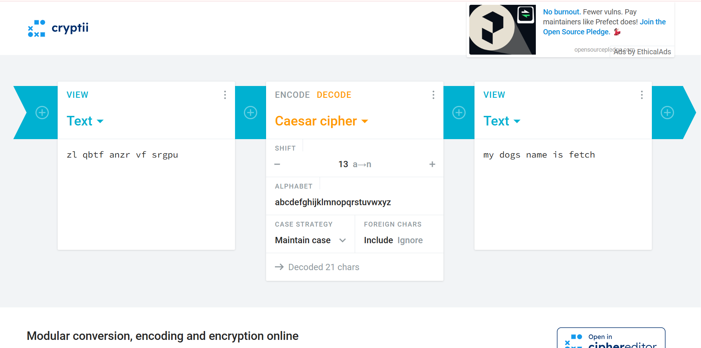
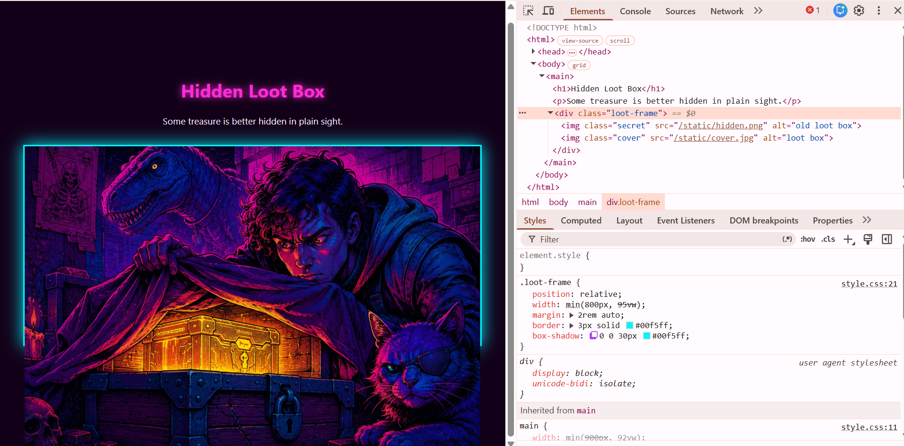
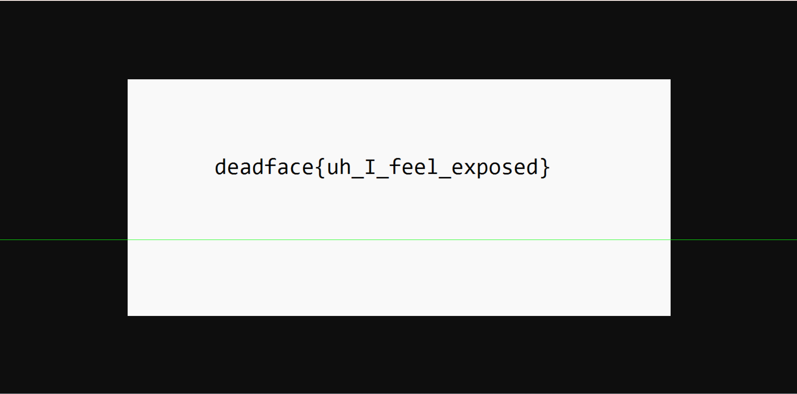

# DEADFACE CTF 2026

## Problems

### Cryptography

**Challenge:** Hail Caesar  
**Author:** @syyntax  
**Points:** 5  

**Problem Statement:**  
One of the faculty at Night Veil University thought it would be clever to write sensitive information on notes by their computer. This sensitive information includes a very easy-to-decipher password hint. Judging by the drawing of a dog on the photo, we assume the password hint is the name of the individual's dog.  

Submit the flag with the dog's name as: `deadface{dog's name}`  

**Attachment:** [PNG file](Hail_Caesar.png)  

**Solution:**  
In the image we can see what seems to be a ciphertext. And the problem statement hints caesar cipher. So I went to [cryptii](https://cryptii.com), selected decode and caesar cipher, and after playing around with shift for a while I got this  

  

**Flag:** `deadface{fetch}`

**Challenge:** DECODE-DLE  
**Author:**  @G2Gh0st
**Points:** 25  

**Problem Statement:**  
One of the junior DEADFACE members left a number puzzle to decipher a 3-digit number combination. Do you have the skills to solve the puzzle and open the lock? Follow the clues to decipher the 3-digit code needed to "pick" the lock. Enter the code as 3 digits, no spaces or other separating characters.

Submit the flag as deadface{###}

**Attachment:** [PNG file](Decoddle.png)

**Flag:** `deadface{716}`

### Steganography

**Challenge:** Headshot
**Author:** @syyntax
**Points:** 10

**Problem Statement:**
DEADFACE was able to compromise a fileshare that consisted of corporate headshots for Aurora Health employees. We believe they're tagging the photos with information that communicates to their group which employees to target in their future campaigns. Figure out which image DEADFACE tampered with - it will give us a heads up on who they plan to target. Submit the answer as deadface{flag_text}.

**Solution:**
A zip file was attached, after unzipping it we found 4 images. Among them there were headshot003.png and another file of similar name. We could deduce from this one of them was hiding something. As this is a png file my first instinct was to pass it through zsteg and voila, we found the flag.

**Challenge:** Hidden Loot Box
**Author:** @RP-01?
**Points:** 15

**Problem Statement:**
Never judge a book by its cover. Think you can discover this secret?

Submit the flag as deadface{flag_text}.

`Click here`(this was hyperlinked to a web page)

This is not a traditional steganography where a file embeds another file. When we go the web page we see an image. First instinct might be to download the image and examine it. But the flag was actually hiding in another image that was placed beneath the image.

We can see this by inspecting the web page. There are two images. One is placed over another and when we see the pic that is behind we can obtain the flag.

